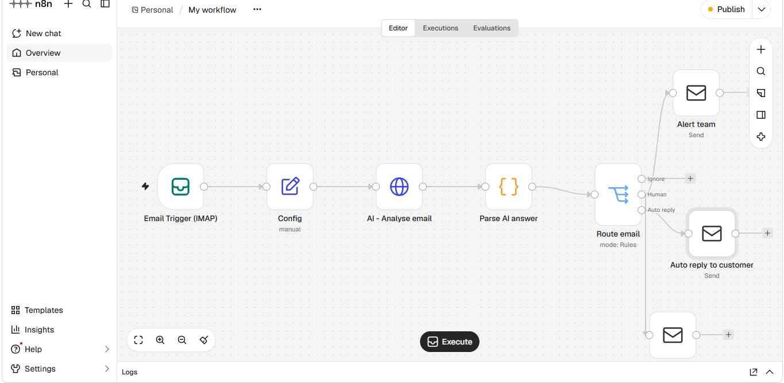

# AI Support Inbox Triage — n8n + LLM

Reads every customer email, classifies it with AI, replies automatically to simple requests, and escalates sensitive ones to a human with a ready-to-send draft.

## The problem
Support teams receive dozens of emails every day: simple questions, bugs, billing issues, angry customers. Someone has to read and sort everything by hand, simple questions eat up time, and urgent cases get lost in the pile.

## The solution
For every new email in the support inbox, an LLM:
1. Detects automated emails (newsletters, notifications) and ignores them
2. Classifies the request: question, technical, billing or complaint
3. Rates urgency (low / medium / high) and sentiment (calm / frustrated / angry)
4. Writes a reply in the customer's language

Then the workflow routes the email:
- **Simple request** → the AI reply is sent automatically
- **Sensitive request** (high urgency, angry customer, billing, account access) → the team gets an alert with an AI summary and a suggested reply to review, and the customer instantly receives an acknowledgement

The AI never replies alone to sensitive cases: **AI suggests, humans decide.**

## Safety features
- **Test mode**: while enabled, every outgoing email goes to an internal address instead of the real customer
- The AI is instructed never to invent prices, policies or facts
- Long emails are truncated to control API costs

## Results (estimated)
- Simple questions answered in under a minute, 24/7
- Urgent cases spotted in seconds instead of hours
- Team handling time per sensitive email: from about 10 minutes to about 1 minute

## Tech stack
- n8n (Email Trigger IMAP, HTTP Request, Code, Switch, Send Email)
- Gemini API through its OpenAI-compatible endpoint (switch to OpenAI, Mistral or Groq by changing two settings)
- IMAP / SMTP (Gmail app password)

## Setup
1. Import `workflow/ai-support-triage.json` into n8n.
2. Create three credentials: **Header Auth** (`Authorization: Bearer YOUR_API_KEY`), **IMAP** and **SMTP** for the support mailbox.
3. Edit the **Config** node: `base_url`, `model`, `company_name`, `support_email`, `team_email`, `test_mode`, `test_recipient`.
4. Mark old emails as read, then activate the workflow.
5. Set `test_mode` to `false` only when you are ready to reply to real customers.

## Authors
MAMA Daniel Dilane — AI automation · [LinkedIn](https://www.linkedin.com/in/daniel-mama-0254b1338/) · [Email](mailto:danielmama881@gmail.com)